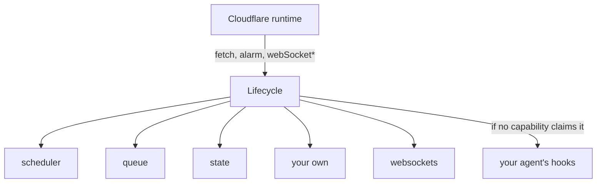

An `Agent` looks like one big class, but it's really a small class holding a list of features. Schedules, the queue, state, WebSockets, tasks and fibers are each a separate object called a capability, and `Agent` just installs them for you.

You don't need any of this to write an agent. It's worth a read once you want to add a feature of your own, or you're trying to work out why an event went where it did.

## Why this exists

Everything is just a Durable Object, and the runtime calls a Durable Object in a fixed number of ways. There's one `fetch`, one `alarm` and one handler each for a WebSocket's message, close and error. RPC methods go straight to your method and skip all of this. The alarm is the awkward one, since an object stores a single timestamp and every `setAlarm` overwrites the last.

An agent needs far more than that. The scheduler might want to wake at 09:00 while the queue wants to wake right now. If they both called `setAlarm`, one would silently lose.

So one object sits in front of all of it. That's `Lifecycle`, and there's one per Durable Object:

`Lifecycle` owns startup, the job table and the one alarm.

`Lifecycle` is SDK code, not a platform feature. It's a normal Python object, built on the same `ctx.storage` and `setAlarm` you'd use yourself.

## How an event finds its capability

A capability overrides the hooks it cares about, and the hook itself decides whether an event is its own. There's no separate "can you handle this?" step.

| Event | Who gets it | How it ends |
| ----- | ----------- | ----------- |
| The first event after a wake | Every `on_start`, in install order, then the host's `on_start` | Once per wake, before anything else runs |
| HTTP request | Each `on_request`, in order | The first to return a `Response` wins. If none does, the host's `on_request`, then a `404`. On an `Agent`, `/sub/...` paths go straight to the sub-agent |
| WebSocket upgrade | Each `on_websocket_upgrade`, in order | The first to return a `Response` owns that socket. If none does, a `404` |
| WebSocket message, close or error | Each matching hook, in order | The first to return `True` consumes it |
| A due job | Only the capability that pushed it | See [one alarm](#one-alarm-many-jobs) |

Install order is the order you called `use`, with one exception. A capability with `claims = "catch-all"` always goes last, and only one catch-all can claim each of `on_request` and `on_websocket_upgrade`. `WebSockets` is the catch-all for upgrades, which is how your own capability still gets to see an upgrade first.

## One alarm, many jobs

Capabilities never touch the alarm. They push rows into one shared table, `cf_agents_jobs`, through `self.lifecycle.jobs`, and `Lifecycle` sets the alarm for the earliest row after every change.

When the alarm fires, each due job goes to the capability that pushed it, one at a time. So a slow `on_job` delays every other job on the object, including your schedules and queue. Once a dispatch takes longer than 30 seconds, the SDK logs a warning and emits `job:slow_dispatch`.

A capability can only see its own jobs, so two capabilities can't cancel each other's work.

## What Agent installs

| Capability id    | What it gives you                                  | Hooks it implements |
| ---------------- | -------------------------------------------------- | ------------------- |
| `dynamic-agents` | [Sub-agents](sub-agents.md)                        | `on_start` |
| `scheduler`      | [`schedule()`](schedules-and-queue.md)             | `on_start`, `on_job`, `on_job_error` |
| `queue`          | [`queue()`](schedules-and-queue.md)                | `on_start`, `on_job`, `on_job_error` |
| `state`          | [`self.state`](state.md)                           | `on_start` |
| `websockets`     | [Connections](connections.md), the upgrade catch-all | `on_websocket_*`, `dispose` |
| `tasks`          | [`@task`](tasks.md)                                | `on_start`, `on_job`, `on_memory_limit` |
| `keep-alive`     | [`keep_alive()`](long-running-work.md)             | `on_start`, `on_job`, `dispose` |
| `fibers`         | [`run_fiber()`](long-running-work.md)              | `on_start`, `on_job` |
| `mcp`            | [MCP servers](mcp-client.md), only with `MCPOptions` | `on_start`, `on_request`, `dispose` |

`AIChatAgent` also installs `sessions`, `streams` and `chat`. A [harness](harness.md) is a capability too, under whatever id you give it.

Your agent's own hooks aren't capabilities. They run after every capability has had its turn, so `Agent.on_start` runs once the capabilities have started, and `Agent.on_request` only sees requests no capability claimed.

## Should you write a capability?

Usually not! Most features fit in a plain method on your `Agent`.

| You need                                                            | Use |
| ------------------------------------------------------------------- | --- |
| Something to run at a time, once or on repeat                       | [`schedule()`](schedules-and-queue.md) |
| Background work with fixed steps                                    | [A durable task](tasks.md) |
| A model calling tools over several steps                            | [A harness](harness.md) |
| To reuse one feature, with its own tables and jobs, across agents   | [A capability](custom-capability.md) |
| To claim requests before `on_request` sees them                     | [A capability](custom-capability.md) |
| Those features on a Durable Object that isn't an `Agent`            | [A capability](custom-capability.md) |

That last row works because capabilities don't depend on `Agent`. [`PydanticAIHarness` on a plain Durable Object](pydantic-ai.md) is one example.

## Limits

- Capabilities are locked in once startup begins, so they can't be added based on what's in storage.
- Hooks run outside the agent's context. On an `Agent`, `get_current_agent()` returns `None` in a hook unless you go through `run_in_host_context`.
- A sub-agent has no alarm of its own. Schedules, the queue, tasks and fibers forward their work to the root agent, using routing that isn't a supported API yet. A harness or your own capability doesn't, so install those on a root agent if they push jobs.

!!! note
    Like the rest of `cf-agents`, this API is alpha and can change between minor releases.

## Next steps

- [Build a capability](custom-capability.md) walks through writing one.
- [Lifecycle and capabilities](lifecycle-class.md) lists every hook, service and option.
