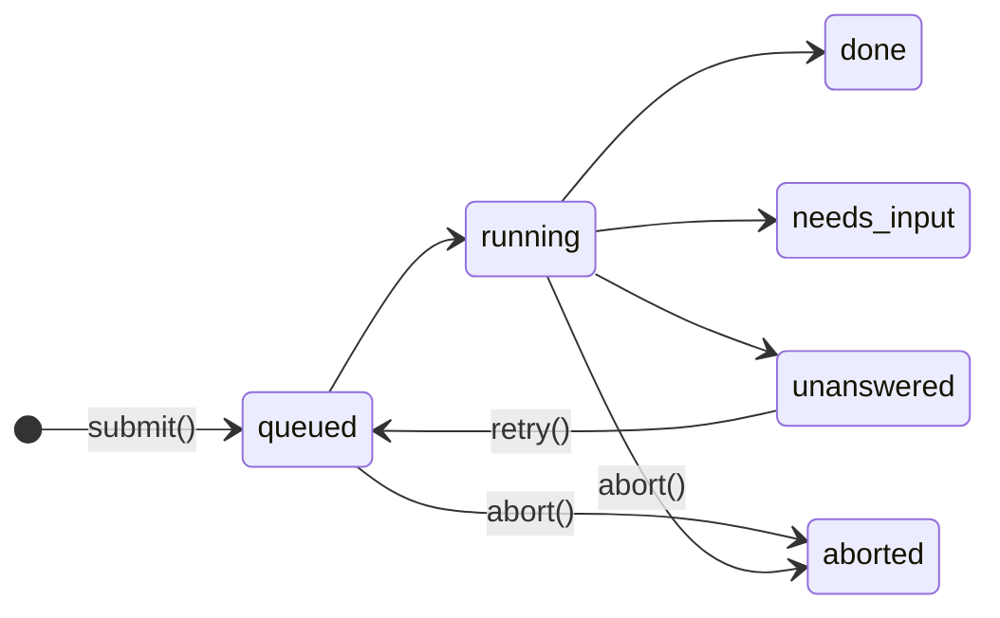

A [`Harness`][agents.Harness] runs an agent loop inside a Durable Object. You submit a prompt, the harness stores it in SQLite as an operation, and it runs operations one at a time per session. If the isolate dies mid-turn, the harness resumes the turn from its last checkpoint.

Use a harness when a model has to call tools over several steps and the work must outlive a deploy or a crash. Use [`AIChatAgent`](chat.md) when you want to write the model call yourself and stream it to a chat client. Use a [durable task](tasks.md) for fixed steps that don't involve a model.

Crosswind ships [`PydanticAIHarness`](pydantic-ai.md). To run a different framework or your own loop, [write your own harness](custom-harness.md). [Harness class](harness-class.md) lists the full API.

## What the base class does

[`Harness`][agents.Harness] owns everything except the turn itself. A subclass implements `run_turn`.

| `Harness` owns                                          | The subclass owns                       |
| ------------------------------------------------------- | --------------------------------------- |
| Storing sessions, operations, history and checkpoints   | The format of history and checkpoints   |
| Queueing prompts and deduping by `operation_id`         | Calling the model                       |
| The wake job that resumes interrupted turns             | Skipping finished work on resume        |
| Publishing events to `watch()` and `stream()`           | Emitting text and tool events           |
| Collecting `@tool` methods from `target`                | Running tools and describing them to the model |

## How an operation moves

Every `submit()`, `prompt()` or `stream()` call creates one operation:

A crash leaves the operation `running`, and it resumes from its checkpoint.

| Status        | Open | Meaning                                                          |
| ------------- | ---- | ---------------------------------------------------------------- |
| `queued`      | Yes  | Waiting for earlier work in the session                          |
| `running`     | Yes  | The turn is running, or it was interrupted and waits to resume   |
| `done`        | No   | Finished. `result.text` has the answer                           |
| `needs_input` | No   | Stopped on tool calls. `result.requests` lists them              |
| `unanswered`  | No   | The turn raised or ran out of restarts. `result.reason` says why |
| `aborted`     | No   | `abort()` stopped it                                             |

Each session runs one operation at a time, oldest first. Different sessions run at the same time as separate asyncio tasks in one isolate.

`needs_input` is a settled status. The client answers with a new operation, and that operation is what continues the conversation.

## What the harness stores

The harness writes three things to the object's SQLite database. Two harnesses on one object keep separate rows because each row has the harness `id` in its key.

| Table                          | Holds                                                                                  |
| ------------------------------ | -------------------------------------------------------------------------------------- |
| `cf_agents_harness_sessions`   | One row per session, with its `history` as bytes                                       |
| `cf_agents_harness_operations` | One row per operation: its input, status, result, `checkpoint` bytes and restart count |
| `cf_agents_jobs`               | One Lifecycle job per session with open work, called the wake job                      |

History changes in the same transaction as the operation's status, and only when the turn returns. An `aborted` or `unanswered` operation leaves the history as it was before the turn.

Events aren't stored. They go to in-memory queues, so a client that reconnects doesn't get the text it missed. Read the result with `wait()` instead.

## How a crash recovers

Every operation row is a record of open work, so recovery only needs something to wake the object and read it.

1. `submit()` writes the operation, pushes the session's wake job and starts the turn in an asyncio task.
2. Lifecycle sets the object's alarm for the wake job. While the turn runs, the job reschedules itself every `heartbeat` (30 seconds by default). Each alarm also keeps the object in memory during a long turn.
3. The turn calls `turn.save(bytes)` before each step. That write replaces the operation's checkpoint.
4. The isolate dies. The operation row still says `running`, and the alarm is still set.
5. The next alarm or request wakes the object. `on_start` pushes a wake job for each session with open work, and the job restarts the turn.
6. The harness calls `run_turn` again with `turn.checkpoint` set and `turn.attempt` increased by 1.
7. After `max_restarts` resumes (5 by default), the operation settles `unanswered` with the reason `"interrupted"`.

With no request to wake it, a turn waits at most one `heartbeat` to resume. On a plain Durable Object, `alarm` must call `self.lifecycle.alarm()` or this wake never happens.

## How each failure ends

| What happened                                                                     | Result                                                                     |
| --------------------------------------------------------------------------------- | -------------------------------------------------------------------------- |
| The isolate died, or a deploy replaced it                                         | The turn resumes from its checkpoint                                       |
| The turn raised a platform failure: a code update, a storage reset or a lost connection | The turn stays `running` and resumes on the next wake job                  |
| The turn raised any other exception                                               | `unanswered`, with the error message as `reason`                           |
| The alarm hit the memory limit 3 times in a row                                   | Running turns settle `unanswered` with the reason `"out_of_memory"`        |
| `abort()`                                                                         | `aborted`. The turn gets `asyncio.CancelledError` and the next operation runs |

Call `session.retry(id)` to run an `unanswered` operation again from its checkpoint. This resets its restart count. It raises `ValueError` if a later operation in the session has already run, because the old checkpoint would drop that turn from the history.

## What can repeat

The harness resumes from the last checkpoint, so anything after that checkpoint runs again. A checkpoint can't record a side effect that finished just before the crash.

| Work after the last checkpoint | After a crash                                                            |
| ------------------------------ | ------------------------------------------------------------------------ |
| A model request                | Sent again, and billed again                                             |
| Text and tool events           | Emitted again, so a watcher sees them twice                              |
| A `@tool(replay="safe")` call  | Runs again                                                               |
| A `@tool(replay="unsafe")` call | Doesn't run again. The harness decides what the model is told            |

Write `replay="safe"` tools so that running twice is harmless, such as a read or an upsert keyed by id. [Recover from a crash](pydantic-ai.md#recover-from-a-crash) lists what `PydanticAIHarness` does with each kind of call.

## Limits

- A session's history and an operation's checkpoint are each one SQLite value. [Durable Objects cap a value at 2 MB](https://developers.cloudflare.com/durable-objects/platform/limits/), and the harness doesn't compact history. A checkpoint `save` over the cap raises, and the turn settles `unanswered`. Call `session.reset()` or start a new session before a conversation reaches it.
- The harness keeps every operation row. Nothing deletes settled operations.
- A sub-agent has no alarm of its own, and a harness doesn't forward its wake job to the root agent. Install it on a root agent, or on a plain Durable Object.
- Prompts are strings, so a harness prompt can't carry an image.
