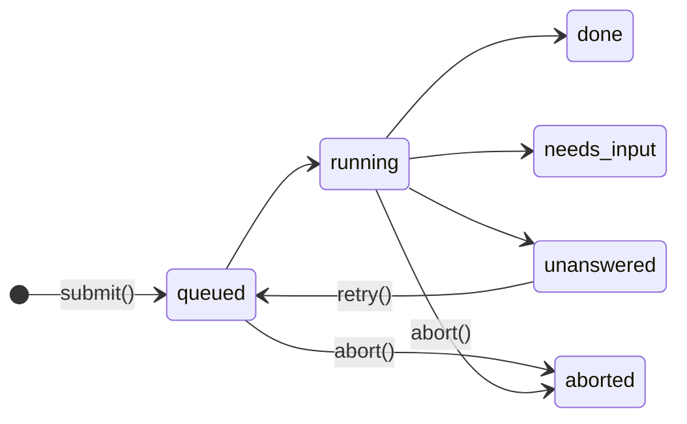

A [`Harness`][agents.Harness] runs an agent loop inside a Durable Object. You submit a prompt, the harness stores it in SQLite as an operation, and it runs operations one at a time per session. It keeps each session's transcript, the messages people see, and streams each reply as it's written. If the isolate dies mid-turn, the harness resumes the turn from its last checkpoint.

Use a harness when a model has to call tools over several steps and the work must outlive a deploy or a crash. Use [`AIChatAgent`](chat.md) when you want to write the model call yourself and stream it to a chat client. Use a [durable task](tasks.md) for fixed steps that don't involve a model.

Crosswind ships [`PydanticAIHarness`](pydantic-ai.md). To run a different framework or your own loop, [write your own harness](custom-harness.md). [Harness class](harness-class.md) lists the full API.

## What the base class does

[`Harness`][agents.Harness] owns everything except the turn itself. A subclass implements `run_turn`.

| `Harness` owns                                          | The subclass owns                       |
| ------------------------------------------------------- | --------------------------------------- |
| Storing sessions, operations, history and checkpoints   | The format of history and checkpoints   |
| The transcript: message ids, the user message, storage  | The assistant message's parts, from its own history |
| Queueing prompts and deduping by `operation_id`         | Calling the model                       |
| The wake job that resumes interrupted turns             | Skipping finished work on resume        |
| Publishing events to `watch()` and `stream()`           | Emitting the reply's chunks as it streams |
| Collecting `@tool` methods from `target`                | Running tools and describing them to the model |

## How an operation moves

Every `submit()`, `prompt()` or `stream()` call creates one operation:

A crash leaves the operation `running`, and it resumes from its checkpoint.

| Status        | Open | Meaning                                                          |
| ------------- | ---- | ---------------------------------------------------------------- |
| `queued`      | Yes  | Waiting for earlier work in the session                          |
| `running`     | Yes  | The turn is running, or it was interrupted and waits to resume   |
| `done`        | No   | Finished. `result.text` has the answer                           |
| `needs_input` | No   | Stopped on tool calls. `result.requests` lists them              |
| `unanswered`  | No   | The turn raised or ran out of restarts. `result.reason` says why |
| `aborted`     | No   | `abort()` stopped it                                             |

Each session runs one operation at a time, oldest first. Different sessions run at the same time as separate asyncio tasks in one isolate.

`needs_input` is a settled status. The client answers with new operations, and the operation that answers the last open request is what continues the conversation. Answers may arrive one operation at a time: an operation that leaves requests open records its answers and settles `done` without running a turn. The first answer to a request wins.

A tool the client runs belongs to the participant who started the turn. Pass `participant=` to `submit`, and a `ToolOutput` from anyone else settles `unanswered` with the reason `"not-owner"`. An answer to a request nobody is waiting for settles `unanswered` with `"not-waiting"`.

## The transcript

Each session keeps a transcript: the messages a person sees, as [`TranscriptMessage`][agents.harness.transcript.TranscriptMessage] records. It's the same shape as upstream's, so a UI or [Channels](https://github.com/cloudflare/agents) can render it directly.

- **One user message per prompt.** Its id is the `message_id` you pass to `submit`, or the operation id. It's written when the operation starts running, not when it's queued, so queued prompts never land between a running turn's messages. Answers write no user message.
- **One assistant message per turn**, with the id `<operation id>:reply`. The subclass reports its parts with every `turn.save` and in the `TurnResult`, so a turn that's aborted or crashes keeps the reply it had saved.
- **A continuation extends the assistant message.** The turn that runs after tool answers writes into the session's latest assistant message instead of starting a new one. The answers themselves show on its tool parts straight away.

A turn publishes its events in this order:

| Event | When |
| ----- | ---- |
| `OperationEvent(status="queued")` | `submit` stored it |
| `MessageEvent` (user) | The operation started |
| `OperationEvent(status="running")` | The operation started |
| `RunStartEvent` | The turn started running, or restarted after a crash |
| `ChunkEvent` | Each streamed piece of the reply. Part ids are unique within the run |
| `MessageEvent` (assistant) | The reply was saved |
| `RunEndEvent` | The turn stopped running |
| `OperationEvent` (settled) | The operation settled |

`watch()` yields a [`SessionSnapshot`][agents.SessionSnapshot] first: the transcript, the open operations, and the run in progress. The run's reply so far is in `run.partial` as chunks, and the transcript shows its message as it was before the run, so a client never sees the reply twice. `session.reset(handoff)` clears the transcript with the history, publishes a `ResetEvent`, and starts the new transcript with the handoff note as a system message.

## What the harness stores

The harness writes four things to the object's SQLite database. Two harnesses on one object keep separate rows because each row has the harness `id` in its key.

| Table                          | Holds                                                                                  |
| ------------------------------ | -------------------------------------------------------------------------------------- |
| `cf_agents_harness_sessions`   | One row per session, with its `history` as bytes and the session it was forked from  |
| `cf_agents_harness_operations` | One row per operation: its input, message id, participant, answers, status, result, `checkpoint` bytes and restart count |
| `cf_agents_harness_messages`   | One row per transcript message, as JSON                                                |
| `cf_agents_jobs`               | One Lifecycle job per session with open work, called the wake job                      |

History changes in the same transaction as the operation's status, and only when the turn returns. An `aborted` or `unanswered` operation leaves the history as it was before the turn.

The transcript is written in the same transaction as the history or checkpoint it goes with: a `save` writes the checkpoint and the reply so far, settling writes the history and the final reply, and `fork` and `reset` copy or clear both. A crash never leaves the transcript ahead of the model's context, or behind it. The transcript is a second copy of the conversation's text, kept because only the turn knows which messages it produced.

Events aren't stored, but the transcript is. A client that reconnects calls `watch()`, whose snapshot has the transcript and the reply in progress.

## How a crash recovers

Every operation row is a record of open work, so recovery only needs something to wake the object and read it.

1. `submit()` writes the operation, pushes the session's wake job and starts the turn in an asyncio task.
2. Lifecycle sets the object's alarm for the wake job. While the turn runs, the job reschedules itself every `heartbeat` (30 seconds by default). Each alarm also keeps the object in memory during a long turn.
3. The turn calls `turn.save(checkpoint, reply=parts)` before each step. That write replaces the operation's checkpoint and the reply so far.
4. The isolate dies. The operation row still says `running`, and the alarm is still set.
5. The next alarm or request wakes the object. `on_start` pushes a wake job for each session with open work, and the job restarts the turn.
6. The harness calls `run_turn` again with `turn.checkpoint` set and `turn.attempt` increased by 1.
7. After `max_restarts` resumes (5 by default), the operation settles `unanswered` with the reason `"interrupted"`.

With no request to wake it, a turn waits at most one `heartbeat` to resume. On a plain Durable Object, `alarm` must call `self.lifecycle.alarm()` or this wake never happens.

## How each failure ends

| What happened                                                                     | Result                                                                     |
| --------------------------------------------------------------------------------- | -------------------------------------------------------------------------- |
| The isolate died, or a deploy replaced it                                         | The turn resumes from its checkpoint                                       |
| The turn raised a platform failure: a code update, a storage reset or a lost connection | The turn stays `running` and resumes on the next wake job                  |
| The turn raised any other exception                                               | `unanswered`, with the error message as `reason`                           |
| The alarm hit the memory limit 3 times in a row                                   | Running turns settle `unanswered` with the reason `"out_of_memory"`        |
| `abort()`                                                                         | `aborted`. The turn gets `asyncio.CancelledError` and the next operation runs |

Call `session.retry(id)` to run an `unanswered` operation again from its checkpoint. This resets its restart count. It raises `ValueError` if a later operation in the session has already run, because the old checkpoint would drop that turn from the history.

## What can repeat

The harness resumes from the last checkpoint, so anything after that checkpoint runs again. A checkpoint can't record a side effect that finished just before the crash.

| Work after the last checkpoint | After a crash                                                            |
| ------------------------------ | ------------------------------------------------------------------------ |
| A model request                | Sent again, and billed again                                             |
| Reply chunks                   | Emitted again in a new run, after a new `RunStartEvent`. The transcript keeps the reply the last checkpoint saved |
| A `@tool(replay="safe")` call  | Runs again                                                               |
| A `@tool(replay="unsafe")` call | Doesn't run again. The harness decides what the model is told            |

Write `replay="safe"` tools so that running twice is harmless, such as a read or an upsert keyed by id. [Recover from a crash](pydantic-ai.md#recover-from-a-crash) lists what `PydanticAIHarness` does with each kind of call.

## Limits

- A session's history and an operation's checkpoint are each one SQLite value. [Durable Objects cap a value at 2 MB](https://developers.cloudflare.com/durable-objects/platform/limits/), and the harness doesn't compact history. A checkpoint `save` over the cap raises, and the turn settles `unanswered`. Call `session.reset()` or start a new session before a conversation reaches it.
- The harness keeps every operation row. Nothing deletes settled operations.
- A sub-agent has no alarm of its own, and a harness doesn't forward its wake job to the root agent. Install it on a root agent, or on a plain Durable Object.
- The transcript has the same 2 MB cap per message. A reply that large fails its `save`, like a checkpoint.
