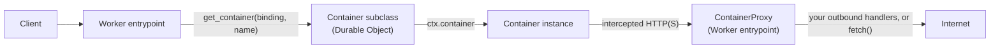
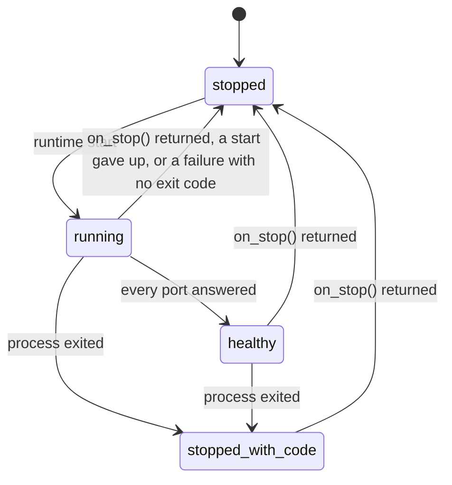

A `Container` subclass looks like a set of class attributes and hooks, but
it's a Durable Object that runs a small control loop for one container
instance. It keeps a stored state, owns the object's alarm, counts requests in
flight and hands the container's outbound traffic to a second entrypoint,
`ContainerProxy`.

You don't need any of this to run a container. It's worth a read once you
want to know why a hook ran when it did, why `alarm()` is off limits, or why
a rule you redeployed didn't reach a running instance.

## One Durable Object per instance

Each Durable Object of your `Container` class owns one container instance,
which the runtime exposes as `self.ctx.container`. The SDK calls that object
to start the container, send it requests, signal it and intercept its traffic.
Every other method, yours and the SDK's, runs on the Durable Object.

Creating the object does a few things before it handles its first call. The
constructor raises `RuntimeError` if the class has no `containers` entry in
your Wrangler config, creates the `container_schedules` table, restores any
outbound rules changed at runtime, sets the alarm to fire in one second and
starts the idle timer. If the container is already running, for example after
the Durable Object left memory and came back, it reattaches to it and
reapplies the outbound rules.

`Container` subclasses the `DurableObject` class from the `workers` module,
which [`crosswind-workers`](../workers/durable-objects.md) or
`workers-runtime-sdk` provides. `self.ctx`, `self.env` and
`self.ctx.storage` are that class's, so its storage and RPC docs apply to your
subclass too.

## The stored state

The SDK records where the container is in its life in Durable Object storage,
so the record outlives the Durable Object leaving memory.
[`get_state()`](lifecycle.md#check-the-state) returns it.

The runtime tells the SDK about an exit through a monitor promise, which
resolves or fails when the process ends. The SDK stores the exit code as soon
as the monitor reports it, but it calls `on_stop()` later, at its next state
check. Three places run that check: the alarm, `stop()` and
`start_and_wait_for_ports()`. The check compares the stored state with
`ctx.container.running`. If the container isn't running and the state says
`running`, `healthy` or `stopped_with_code`, the SDK calls `on_stop()`, and
moves the state to `stopped` only after the hook returns. A hook that raises
leaves the state where it was, so the next check calls it again.

The state only moves to `stopped` if nothing changed it while `on_stop()`
ran. An `on_stop()` that starts a new container therefore leaves the new
container's `running` state in place.

## One alarm

A Durable Object has one alarm, and `Container` uses it as its clock. It's
how schedules run, how the idle timer gets checked and how `on_stop()` gets
called when nobody is sending requests. This is why you
[shouldn't override `alarm()`](lifecycle.md#control-when-a-container-sleeps).

Each time the alarm fires, the SDK:

1. Runs every [`schedule()`](container-class.md#scheduling) task that is
   due, then deletes it, even if the callback raised. A task whose callback
   no longer exists on the class is logged and left in the table.
2. If the container isn't running, runs the state check, then sets the alarm
   for the next scheduled task, or clears it when there are none.
3. If the idle timer has expired, calls `on_activity_expired()` and renews
   the timer.
4. Otherwise it waits inside the alarm handler until the next scheduled task,
   the idle deadline or three minutes from now, whichever comes first, then
   sets the alarm to fire again at once.

So while a container runs, the alarm handler is almost always running too, and
the SDK checks the container at least every three minutes. When the monitor reports an
exit, the SDK cuts that wait short, so the next alarm finds the container
stopped and calls `on_stop()`. `schedule()` and every start cut the wait
short too, so the alarm runs again right away and picks up the change.

When the runtime retries a failed alarm more than three times, the SDK skips
its work for that attempt and only sets the alarm again if there are
scheduled tasks or a running container.

## Activity and sleep

The idle timer is a deadline, `sleep_after` from the last renewal. These
renew it:

- creating the Durable Object,
- each attempt of a start,
- each request through `fetch()` or `container_fetch()`, and each WebSocket
  message it proxies,
- the last request in flight finishing,
- `renew_activity_timeout()`.

The SDK counts requests in flight. A streamed response body counts until it
finishes, and a proxied WebSocket counts until either side closes it. While
the count is above zero, the alarm treats the container as active and renews
the deadline instead of expiring it.

A call to one of your own RPC methods isn't activity unless it sends a request
through `container_fetch()`. Work that reaches the container some other way,
or that the container does on its own, needs
`self.renew_activity_timeout()`. [Build on the Container
class](extend-container.md#keep-the-container-awake-for-your-own-work) shows a
pattern for that.

## Starting once

Several requests can arrive while a container is stopped. The SDK runs one
start and makes every caller wait for it, so the runtime never gets a second
start call for a running container. If one caller is cancelled, the start
carries on for the others.

A start that finds the container already running returns without starting
anything, which is why `env_vars`, `entrypoint`, `enable_internet` and
`labels` passed to a start only apply when that call starts the container.

`fetch()` and `container_fetch()` skip the start path only when the
container is running and the state is `healthy`. After `start()`, which
leaves the state `running`, the first request goes through
`start_and_wait_for_ports()` for its port and runs `on_start()` again.

## Outbound rules and ContainerProxy

Outbound handlers don't run in your Durable Object. The runtime sends each
intercepted request to a fetcher the SDK builds from
`self.ctx.exports.ContainerProxy`, a Worker entrypoint. The fetcher carries
the rules as props: the Durable Object's ID, your class name, the host lists,
`enable_internet` and any rules changed at runtime. `ContainerProxy` then
applies the [precedence order](outbound-traffic.md#precedence).

The handler functions themselves can't travel as props. Every `Container`
subclass registers itself by class name when Python defines it, and
`ContainerProxy` looks the class up by that name to find `outbound`,
`outbound_by_host` and `outbound_handlers`. Two subclasses with the same
name in one Worker share one registry entry, and the one defined last wins.
Give every `Container` subclass in a Worker its own name.

The SDK intercepts in one of two modes:

| Mode          | When                                                                                             | What the runtime sends to `ContainerProxy`                  |
| ------------- | ------------------------------------------------------------------------------------------------ | ----------------------------------------------------------- |
| Per host      | No catch-all, no host list and no runtime change, so at most class-level `outbound_by_host` | Requests to the `outbound_by_host` hosts                   |
| Intercept-all | A catch-all `outbound`, a host list, or any rule changed at runtime                          | All HTTP, and all HTTPS when `intercept_https` is `True`    |

Once an instance has used intercept-all, the SDK records it and keeps using
intercept-all for that Durable Object, across restarts of the container.

The SDK applies the rules before each start of the container, after each
runtime change such as `allow_host()`, and when a Durable Object is created
while its container is already running. A class with no outbound attributes
and no runtime changes registers no intercepts, and `enable_internet = False`
on its own goes to the runtime as a start option.

## What the SDK stores

!!! note
    These names are internal and may change between releases. They're listed
    so your own storage doesn't collide with them.

| Name                    | Storage API                          | Holds                                                    |
| ----------------------- | ------------------------------------ | -------------------------------------------------------- |
| `__CF_CONTAINER_STATE`  | `ctx.storage` key-value              | The state: `status`, `lastChange` and `exitCode`        |
| `OUTBOUND_CONFIGURATION` | `ctx.storage.kv`                     | Rules changed at runtime, and whether intercept-all is on |
| `container_schedules`   | `ctx.storage.sql` table              | Pending `schedule()` tasks                               |
| The alarm               | `ctx.storage.setAlarm`               | The SDK's next check                                      |

The records use the same `camelCase` field names as the TypeScript SDK's,
such as `lastChange`.

## Next steps

- [Manage the lifecycle](lifecycle.md) for the hooks, timeouts and sleep in
  practice.
- [Build on the Container class](extend-container.md) to add your own methods
  and data to a subclass.
- [Control outbound traffic](outbound-traffic.md) for the rules
  `ContainerProxy` applies.
