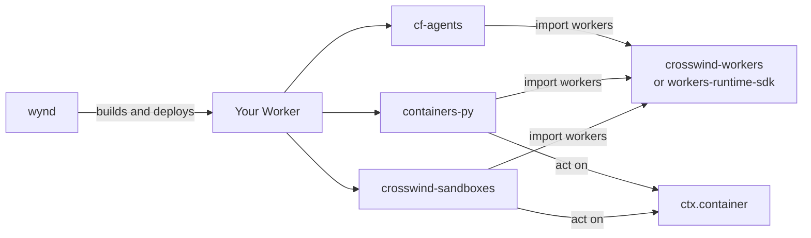

Crosswind is a set of Python SDKs for
[Python Workers](https://developers.cloudflare.com/workers/languages/python/).

Cloudflare currently ships great developer SDKs for TypeScript, not for Python, which is what Crosswind aims to solve. Each Crosswind package ports one of these SDKs, bringing familiar APIs to Python, while abstracting any Pyodide or FFI work from you.

Each Crosswind SDK speaks the same wire protocols as it's official counter-part. This means you can use any client-side tools provided by the official SDKs to speak to Crosswind.

| Package                                       | What it does                                                                         | Official Counterpart                                                                   |
| --------------------------------------------- | ------------------------------------------------------------------------------------ | ----------------------------------------------------------------------- |
| [`crosswind-workers`](workers/overview.md)    | The runtime SDK every Python Worker imports, with types on bindings, requests and Durable Objects. | [`workers-runtime-sdk`](https://github.com/cloudflare/workers-py)       |
| [`wynd`](wynd/overview.md)                    | Builds, runs and deploys Python Workers, and drops unused package files before upload. | [pywrangler](https://github.com/cloudflare/workers-py)                  |
| [`cf-agents`](agents/overview.md)             | Stateful agents with WebSocket clients, schedules, durable tasks and streaming chat. | [`@cloudflare/agents`](https://developers.cloudflare.com/agents/)                 |
| [`containers-py`](containers/overview.md)     | Starts, stops and routes requests to Cloudflare Containers, and filters their outbound traffic. | [`@cloudflare/containers`](https://github.com/cloudflare/containers)   |
| [`crosswind-sandboxes`](sandboxes/overview.md) | Reads and writes files, mounts S3 buckets and backs up directories in a sandbox container. | [`@cloudflare/sandbox`](https://developers.cloudflare.com/sandbox/)               |

## Why Crosswind?

- [x] Built on top of Durable Objects, just like the official SDKs. Everything is just a Durable Object.
- [x] Pythonic APIs. We replace TypeScript APIs with more Pythonic options where sensible.
- [x] No Pyodide or FFI faff. All APIs we expose expect standard Python types. If a conversion is needed, we handle it under the hood.
- [x] Fully-typed. You don't need to run a command generating a 10,000 line stub file. Our stubs already exist.

## How the packages fit together

Every Python Worker imports the `workers` module, and exactly one runtime SDK
provides it: `crosswind-workers` or Cloudflare's `workers-runtime-sdk`.
Declare one of them in `pyproject.toml`, never both.

`cf-agents`, `containers-py` and `crosswind-sandboxes` don't depend on
`crosswind-workers`, and none of them depends on another. They list no runtime
SDK at all. They import `workers` from whichever one your project declares.
The `cf-agents` and `containers-py` test suites run against
`workers-runtime-sdk`.

`containers-py` and `crosswind-sandboxes` both act on the Durable Object's
container, `ctx.container`. `containers-py` manages it from the outside:
starting, stopping, sleeping, routing requests and filtering outbound traffic.
`crosswind-sandboxes` works inside it: files, S3 mounts and directory backups.
Sandboxes takes `ctx.container` directly, so it doesn't need a `Container`
subclass.

Using sandboxes inside a `Container` subclass isn't documented yet. A
`Container` with outbound rules registers `interceptAllOutboundHttp()`
before it starts the container, and S3 mounts and backups only work if their
intercepts are registered before that catch-all. See
[Mount an S3 bucket](sandboxes/s3-mounts.md) and
[Use with a catch-all intercept](sandboxes/backups.md#use-with-a-catch-all-intercept).

`wynd` builds, runs and deploys the Worker, whichever of these packages it
uses. It works with either runtime SDK, but `wynd types` generates a typed
`Env` only for `crosswind-workers`.

## Picking a Runtime SDK and a Build Tool

Cloudflare ships [pywrangler](https://github.com/cloudflare/workers-py) and
[`workers-runtime-sdk`](https://github.com/cloudflare/workers-py). They're both great!

Crosswind provides its own opinionated build tool, [`wynd`](wynd/overview.md), and its own runtime SDK, [`crosswind-workers`](workers/overview.md). They are not required, but they were built to make working with Python Workers that bit nicer:

- [x] Auto-magically generate typed `Env` stub. Workers using `crosswind-workers` can accept this as a generic!
- [x] Keep Node.js build artifacts out of your Python codebase.
- [x] Write your worker configurations with a typed [`cloudflare.config.py`](wynd/python-config.md) instead of using JSONC or TOML.

This is just a few things Crosswind gives you. You can use `wynd`, `crosswind-workers`, both, or neither. The other Crosswind packages don't require either one.

## Limits

Python Workers run on [Pyodide](https://pyodide.org/en/stable/), CPython compiled to WebAssembly. A package with C extensions works only if Pyodide
ships a build of it, so not every library on PyPI imports in a Worker. This is a limitation with the runtime itself, not the SDKs.

## Status

Every Crosswind package is alpha and pre-1.0. A minor release can rename or
remove an API, so pin exact versions and test each upgrade before you deploy
it.

!!! note
    Crosswind is an independent community project. It isn't affiliated with or
    endorsed by Cloudflare.

## Help, contributing and licensing

- Ask questions in the [Crosswind Discord](https://discord.gg/tbZTEeK35p), or
  open an issue on [GitHub](https://github.com/justanotherbyte/crosswind).
- Pull requests are welcome, including ones written with AI tools. Keep them
  to the code quality of the surrounding package.
- Each package uses the license of the TypeScript SDK it ports. The docs are
  MIT-licensed.
