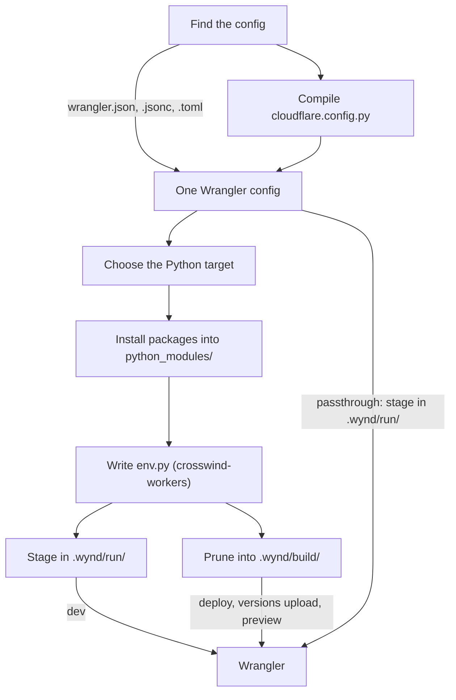

Wynd doesn't serve or upload anything itself. Every command that touches a
Worker ends in a Wrangler run, and everything Wynd does first is about giving
that run the right config and the right files. Read this page when a path
resolves somewhere unexpected, when the deployed Worker behaves differently
from `wynd dev`, or when you want to know what an upload contains.

## Why this exists

A Python Worker needs its packages installed for the Python it runs on,
which is a Pyodide build chosen by the compatibility date, not the Python on
your machine. Wynd installs them into `python_modules/`, keeps the upload
down to the files your code can import, and writes an `Env` class for
crosswind-workers. Apart from `pylock.toml` and `env.py`, which you commit,
everything it writes goes under `.wynd/`, and it never edits your config.

Wrangler reads its config and the files beside it, such as
`python_modules/`, `.dev.vars` and `.wrangler/state/`. So Wynd never hands
Wrangler your config. It writes a copy into `.wynd/`, puts the files Wrangler
expects beside that copy, and runs Wrangler on it. Most of Wynd's rules
follow from that one choice.

## The steps

| Command                                   | Install | `env.py` | Staged in      | Prunes |
| ----------------------------------------- | ------- | -------- | -------------- | ------ |
| `wynd dev`                                | Yes     | Yes      | `.wynd/run/`   | No     |
| `wynd deploy`, `versions upload`, `preview` | Yes   | Yes      | `.wynd/build/` | Yes    |
| `wynd sync`                               | Yes     | No       | Nothing        | No     |
| `wynd types`                              | No      | Yes      | Nothing        | No     |
| Any other command                         | No      | No       | `.wynd/run/`   | No     |

"Yes" for `env.py` means on crosswind-workers projects only.

## One config, as Wrangler will read it

Wynd finds your config the way Wrangler does, with `cloudflare.config.py`
added to the search, and uses the nearest `pyproject.toml` as the project
root. [Config discovery](commands.md#config-discovery) has the exact order.

A `cloudflare.config.py` runs on every command but `wynd init`, passthrough
commands included, and compiles to a plain Wrangler dictionary. From then on Wynd
treats both kinds of config the same way. It reads `main`, the compatibility
date, the bindings and everything else from the same dictionary it later
writes for Wrangler, so what Wynd installs and types for always matches what
Wrangler runs.

The difference between the two kinds is who applies `--env`. A Wrangler file
keeps its `env` sections, and Wrangler applies `--env` itself. A Python
config takes the name as a [mode](python-config.md#use-modes), and runs once
per mode. Its output has no `env` sections, so Wynd removes `--env` and
`CLOUDFLARE_ENV` before Wrangler runs.

## The target decides the packages

`compatibility_date` and the `python_workers` flags pick the Python version,
and with it the interpreter and Pyodide package index uv resolves against.
[Python targets](commands.md#python-targets) lists them. uv locks
`[project] dependencies` into `pylock.toml` for that target, and installs the
lock into `python_modules/`. The `dev` dependency group never reaches the
Worker.

Wynd skips the install when nothing it depends on changed since the last
one: `pyproject.toml`, `pylock.toml`, the config's path, the target and the
Wynd version. [When packages reinstall](commands.md#when-packages-reinstall)
has the full list.

The target is fixed before Wrangler starts, which is why Wynd refuses
`--compatibility-date`, `--compatibility-flags` and `--latest` on `wynd dev`
and the upload commands. Wrangler would apply them to packages already built
for another Python.

## Two staged trees

`.wynd/run/<directory>/` stands in for your config's directory on `wynd dev`
and passthrough commands. It holds the staged config, the full
`python_modules/`, copies of `.dev.vars*` and `.env*`, and Wrangler's
`.wrangler/state/`. Wynd rewrites relative paths in the staged config, such
as `assets.directory` and D1 `migrations_dir`, so they still point into your
project. [Staged config](commands.md#staged-config) lists the keys.

`.wynd/build/` is what the upload commands send. Wynd deletes it, copies
your source directory into it unchanged, adds the package files that pruning
kept, and writes `wrangler.json` beside them. It's rebuilt on every upload,
and it's shared by every config in the project.

The two trees are why `wynd dev` and a deployed Worker can differ. Dev runs
every installed package, so a new import works straight away. An upload runs
only what pruning kept. When something works under `wynd dev` and fails after
deploy, compare `.wynd/shake.txt` with what the Worker imports, as
[Prune the upload](pruning.md#troubleshooting) describes.

Staging also explains two things that surprise people. Plain `npx wrangler`
on a project that uses Wynd reads neither the compiled config nor
`.wynd/run/.wrangler/state/`. And anything Wrangler writes into the staged
config, such as a binding from `d1 create`, is lost on the next run, which
is why Wynd warns you to copy it into your own config.

## Pruning

Pruning reads imports from your entry module through the installed packages
without running them, and keeps the files those imports can reach plus
everything a kept package might load by path. It strips comments and
docstrings from the package modules it keeps, and never changes your own
source. [Prune the upload](pruning.md) explains its rules and how to keep a
module it can't see.

## What you can rely on

Wynd is pre-1.0, so all of this can change between minor releases. The parts
meant for you to use are the commands and their flags, `[tool.wynd]`, the
files in [Files](commands.md#files), and the classes in `wynd.config`.

Everything else in the `wynd` package is internal, even where a module has
public names. That includes `wynd.config.bindings.Binding`,
`wynd.config.triggers.Trigger` and `wynd.config.exports.Export`, the base
classes each binding, trigger and export compiles through. Subclassing them
isn't a supported way to add a binding kind yet, and may break in any
release.

## Next steps

- [Commands and configuration](commands.md) has the exact rules for each
  step.
- [Run several Workers in one project](multiple-workers.md) shows what the
  shared `pylock.toml` and `.wynd/build/` mean for a project with more than
  one config.
- [Prune the upload](pruning.md) covers the upload tree in detail.
